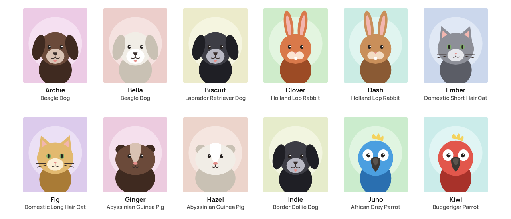
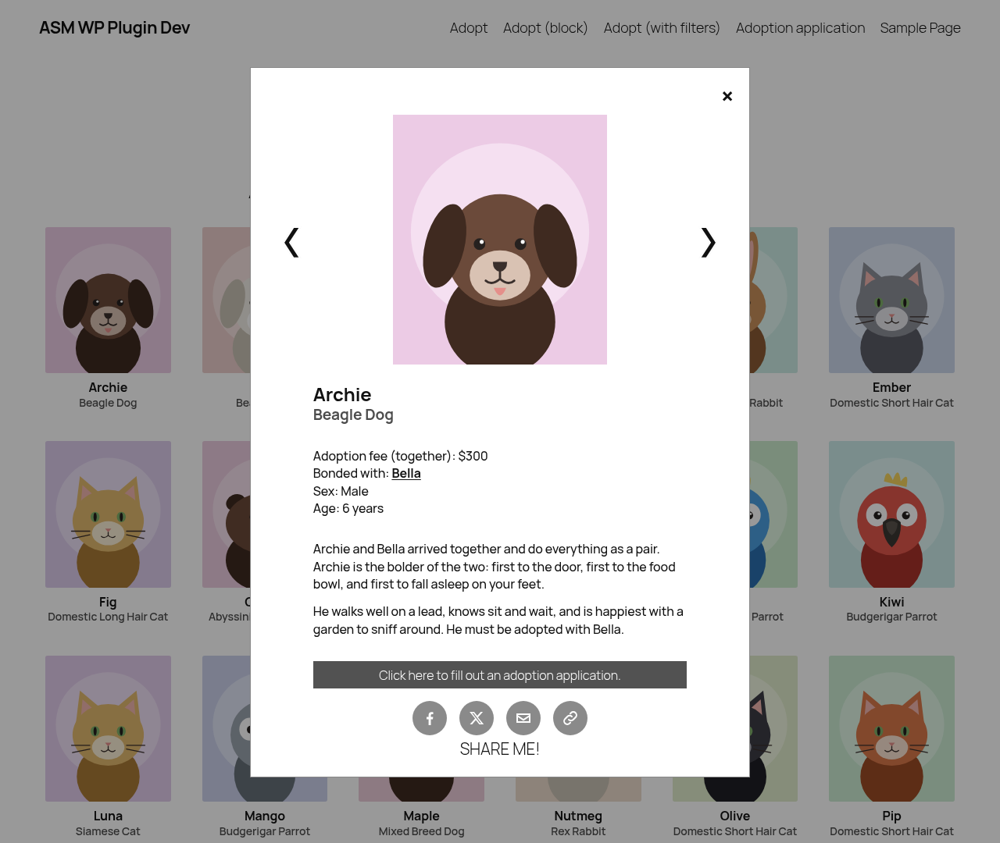
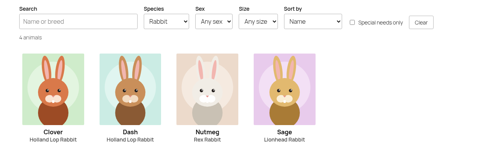
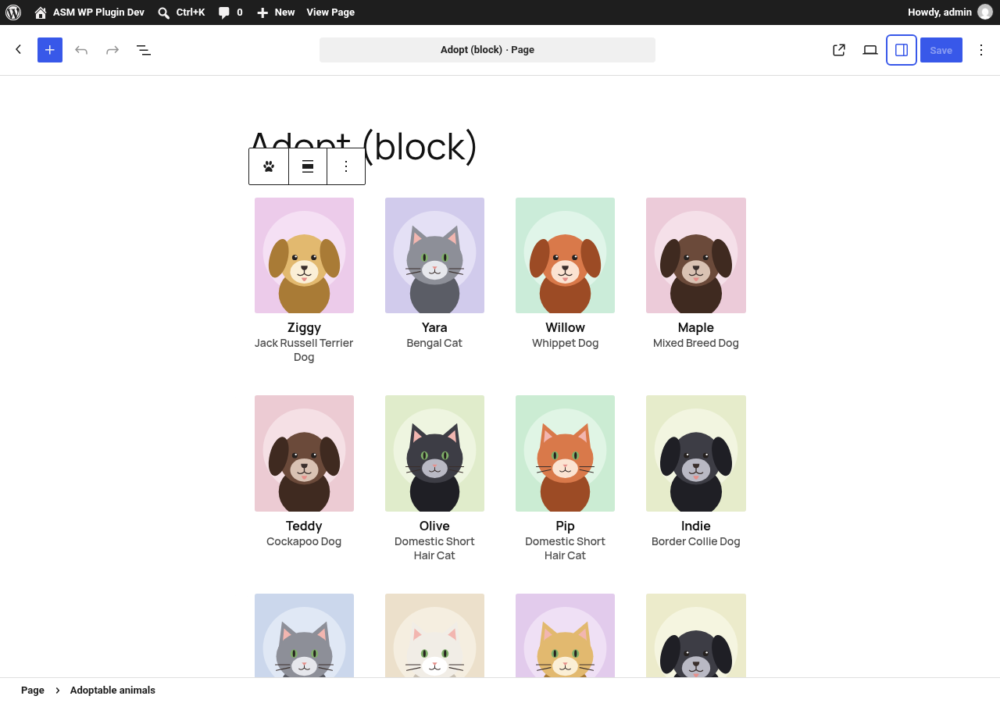
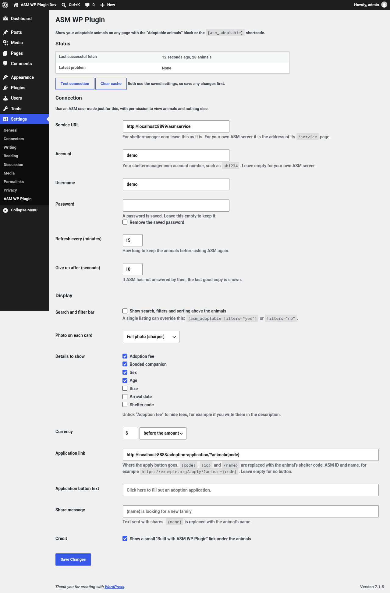
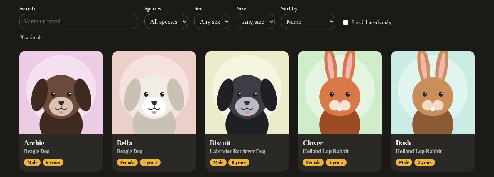

# ASM WP Plugin

[](https://github.com/St-Louis-Avian-Rescue/asm-wp-plugin/actions/workflows/ci.yml)

Show the adoptable animals from your [Animal Shelter Manager](https://sheltermanager.com) account on a WordPress site.



| Details dialog | Search and filters |
| --- | --- |
|  |  |

The pictures here use made-up animals and drawn stand-in photos from the development setup. On a real site the photos come from your ASM account.

## Features

- A grid of cards, and a details dialog with a photo carousel, fee, sex, age, special-needs flag, description, apply button and share links.
- Bonded animals link to each other and show a combined fee.
- An optional search and filter bar. The filtered view is kept in the address bar, so it can be shared.
- A link for every animal (`?animal=123`) that opens their details.
- Animals are cached. If ASM is unreachable, the last good copy stays up.
- Works behind full-page caches and CDNs: a stale page updates its own listing in the browser.
- Rendered on the server, so the listing is in the page source and works without JavaScript.
- Follows your theme's fonts and colours, and can be restyled with CSS custom properties or template overrides.
- Works with sheltermanager.com accounts and self-hosted ASM3 servers.

Requires WordPress 6.3 and PHP 7.4, or later.

## Quick start

1. **Get the zip.** Clone this repository and run `dev/bin/dev zip`. It writes `asm-wp-plugin.zip`, with only the files a site needs.
2. **Install it.** In WordPress, go to **Plugins → Add New → Upload Plugin**, upload the zip and activate it.
3. **Connect to ASM.** Open **Settings → ASM WP Plugin**. Enter your account number and the username and password of an ASM user, save, then click **Test connection**.
4. **Add the listing to a page.** Insert the **Adoptable animals** block, or type the shortcode `[asm_adoptable]`.

Create an ASM user just for the website, with permission to view animals and nothing else.

## Shortcode and block

```
[asm_adoptable]
[asm_adoptable filters="yes"]
[asm_adoptable species="Cat" sort="newest" limit="8" columns="4"]
[asm_adoptable filters="search,species"]
```

| Attribute | Values | Default |
| --- | --- | --- |
| `species` | Species to include, separated by commas | all |
| `sort` | `name`, `newest` (newest arrivals), `youngest`, `oldest` | `name` |
| `limit` | The most animals to show | all |
| `columns` | A fixed number of columns, 1 to 8 | as many as fit |
| `filters` | `yes`, `no`, or the controls to show: `search`, `species`, `sex`, `size`, `special`, `sort` | the setting |

The block has the same options in its sidebar.



The filter bar only lists values that are present, and leaves out a menu that would have a single choice. Its state goes in the address bar, for example `?asm_species=Rabbit&asm_q=lop`.

## Settings



**Connection**

| Setting | Notes |
| --- | --- |
| Service URL | Keep the default for sheltermanager.com. For your own ASM server, use the address of its `/service` page. |
| Account | Your sheltermanager.com account number, such as `ab1234`. Leave empty for your own server. |
| Username, Password | The ASM user to fetch with. The saved password is never sent back to the browser; leave the box empty to keep it. |
| Refresh every | How long to keep the animals before asking ASM again. Default 15 minutes. |
| Give up after | How long to wait for ASM. Default 10 seconds. |

**Test connection** reports how many animals ASM returned. **Clear cache** throws away the stored copy and fetches again.

**Display**

| Setting | Notes |
| --- | --- |
| Search and filter bar | Off by default. Turns the bar on for every listing; a shortcode or block can override it. |
| Photo on each card | The full photo (sharper) or ASM's thumbnail (faster). |
| Details to show | Adoption fee, bonded companion, sex, age, size, arrival date, shelter code. Untick "Adoption fee" to hide fees. |
| Currency | The symbol, and whether it goes before or after the amount. |
| Application link | Where the apply button goes. `{code}`, `{id}` and `{name}` become the animal's shelter code, ASM ID and name. Leave empty for no button. |
| Application button text | The label on the apply button. |
| Share message | The text sent with shares. `{name}` becomes the animal's name. |
| Credit | A small "Built with ASM WP Plugin" link under the animals. On by default; untick to remove it. |

### Credentials in wp-config.php

To keep the credentials out of the database, define any of these. They take priority over the saved values.

```php
define( 'ASM_WP_PLUGIN_SERVICE_URL', 'https://service.sheltermanager.com/asmservice' );
define( 'ASM_WP_PLUGIN_ACCOUNT', 'ab1234' );
define( 'ASM_WP_PLUGIN_USERNAME', 'website' );
define( 'ASM_WP_PLUGIN_PASSWORD', '...' );
```

## Theming

The listing uses your theme's fonts and text colour. The dialog uses the theme's base and contrast colours when the theme defines them, as block themes do.



That is `dev/themes/asm-wp-plugin-demo`, a small child theme that sets a few custom properties and overrides the card template.

### Custom properties

Set them on `.asm-wp-plugin`, in your theme's stylesheet or under **Appearance → Additional CSS**:

```css
.asm-wp-plugin {
	--asm-wp-plugin-accent: #0a6e5c;
	--asm-wp-plugin-card-min: 14rem;
	--asm-wp-plugin-image-ratio: 1 / 1;
	--asm-wp-plugin-radius: 0.75rem;
}
```

<details>
<summary>All custom properties</summary>

| Property | Default | What it changes |
| --- | --- | --- |
| `--asm-wp-plugin-card-min` | `10.5rem` | Smallest card width; the grid fits as many columns as it can |
| `--asm-wp-plugin-gap` | `1.5rem` | Space between cards |
| `--asm-wp-plugin-image-ratio` | `6 / 7` | Card photo width to height |
| `--asm-wp-plugin-radius` | `0.2rem` | Corner radius |
| `--asm-wp-plugin-hover-scale` | `1.1` | How much a card grows on hover |
| `--asm-wp-plugin-text` | `inherit` | Text colour |
| `--asm-wp-plugin-muted-opacity` | `0.75` | Opacity of secondary text |
| `--asm-wp-plugin-accent`, `--asm-wp-plugin-accent-text` | `#525252`, `#fff` | Apply button |
| `--asm-wp-plugin-special` | `#d40e0e` | "Has special needs" |
| `--asm-wp-plugin-overlay` | `rgba(0, 0, 0, 0.4)` | Backdrop behind the dialog |
| `--asm-wp-plugin-modal-bg`, `--asm-wp-plugin-modal-text` | theme base and contrast, else `#fff` and `#403d3d` | Dialog colours |
| `--asm-wp-plugin-modal-border` | `#888` | Dialog border |
| `--asm-wp-plugin-modal-width` | `40rem` | Dialog width |
| `--asm-wp-plugin-modal-font-size` | `1rem` | Dialog text size |
| `--asm-wp-plugin-slide-height` | `20rem` | Photo height in the dialog |
| `--asm-wp-plugin-share-bg`, `--asm-wp-plugin-share-text` | `#8a8a8a`, `#fff` | Share buttons |
| `--asm-wp-plugin-field-border`, `--asm-wp-plugin-field-bg` | grey, transparent | Filter bar fields |

</details>

### Template overrides

Copy a file from the plugin's `templates/` folder into an `asm-wp-plugin/` folder in your theme, and edit the copy.

| Template | What it is |
| --- | --- |
| `card.php` | One animal in the grid |
| `detail.php` | An animal's details inside the dialog |
| `filters.php` | The search and filter bar |
| `modal.php` | The dialog frame |
| `grid.php` | The wrapper around everything |

Keep the `data-*` attributes, because the page script finds its elements through them. The values passed to `card.php` and `detail.php` are listed in `ASM_WP_Plugin_Animals::present()`.

### Hooks

| Filter | Use |
| --- | --- |
| `asm_wp_plugin_map_animal` | Keep more fields from the ASM row. Anything added is public. |
| `asm_wp_plugin_feed` | Change the animals before they are cached. |
| `asm_wp_plugin_present_animal` | Change the values passed to the card and detail templates. |
| `asm_wp_plugin_image_url` | Rewrite photo URLs, for example to a resizing proxy. |
| `asm_wp_plugin_template` | Change which template file is used. |
| `asm_wp_plugin_settings` | Override settings in code. |
| `asm_wp_plugin_request_args` | Change the arguments of the request to ASM. |
| `asm_wp_plugin_retry_seconds` | How long to wait after a failed fetch. Default 120. |

## Full-page caches and CDNs

If your site caches whole pages (Cloudflare "cache everything", WP Rocket, a host-level cache), a cached page can show animals who have since been adopted. The plugin handles this in the browser:

- After the page loads, the script asks `/wp-json/asm-wp-plugin/v1/status` whether the listing has changed. If it has, it fetches the current cards and swaps them in.
- An animal's details are loaded fresh each time they are opened.

This only works if the REST routes are not cached. Every response is sent with `Cache-Control: no-store`, which most caches respect. If yours ignores that header, add a bypass rule for:

```
/wp-json/asm-wp-plugin/*
```

The routes are public and read-only:

| Route | Returns |
| --- | --- |
| `GET /wp-json/asm-wp-plugin/v1/status` | A fingerprint of the current listing, and the animal count |
| `GET /wp-json/asm-wp-plugin/v1/animals` | The public fields of every animal. Accepts `species`, `sort`, `limit`. |
| `GET /wp-json/asm-wp-plugin/v1/animals/<id>` | One animal, plus its details rendered by `detail.php` |
| `GET /wp-json/asm-wp-plugin/v1/grid` | The cards and filter bar rendered by your theme's templates |

## What is stored

The plugin keeps and serves only these fields: ID, name, breed, species, shelter code, description, sex, size, special-needs flag, date of birth, arrival date, fee, bonded companions and photo count. Everything else in the ASM record, such as owners, addresses and internal notes, is discarded when it is fetched.

Photos are loaded by the visitor's browser straight from your ASM service.

## Development

You need Docker with Compose. Node.js is only needed for the browser checks.

```sh
dev/bin/dev up
```

This starts WordPress at http://localhost:8888 (admin login `admin` / `admin`) and a mock ASM service at http://localhost:8889, with the plugin active and connected to the mock. No ASM account is needed. Demo pages are created at `/adopt/`, `/adopt-filters/` and `/adopt-block/`.

If a port is taken, set `ASM_DEV_WP_PORT` or `ASM_DEV_MOCK_PORT` before running any `dev/bin/dev` command.

| Command | Does |
| --- | --- |
| `dev/bin/dev test` | Runs PHPUnit with the WordPress test suite |
| `dev/bin/dev lint` | Runs PHPCS with the WordPress standard |
| `dev/bin/dev asm down` / `up` | Makes the mock ASM fail, or work again |
| `dev/bin/dev asm hide <id>` | Drops an animal from the feed, as if adopted |
| `dev/bin/dev expire` | Marks the cached animals as out of date |
| `dev/bin/dev theme demo` / `default` | Switches between the demo theme and the stock theme |
| `dev/bin/dev pot` | Regenerates the translation template |
| `dev/bin/dev zip` | Builds `asm-wp-plugin.zip` from the last commit |
| `dev/bin/dev down` / `destroy` | Stops the containers; `destroy` also deletes the data |

`dev/bin/dev help` lists the rest.

### Browser checks

```sh
cd dev/e2e
npm install
node run.mjs
```

This drives Chromium through the listing, the dialog, sharing, links to one animal, the filter bar, the block and its editor, the cached-page refresh, ASM being down, the demo theme, a phone-sized screen and the settings page. Set `CHROMIUM` if your browser is not at `/usr/bin/chromium`. Screenshots go to `dev/e2e/screenshots/`.

### Continuous integration

GitHub Actions runs PHPCS, PHPUnit (on PHP 7.4 and 8.3) and the browser checks on every push to `main` and on every pull request. The workflow is `.github/workflows/ci.yml`.

### Where things are

| Path | Contents |
| --- | --- |
| `asm-wp-plugin.php` | Plugin header and startup |
| `includes/` | Settings, the ASM client and cache, field mapping, rendering, REST routes, block, admin page |
| `templates/` | The templates a theme can override |
| `assets/`, `block/` | Stylesheet, page script and block editor script. There is no build step. |
| `languages/` | Translation template |
| `tests/` | PHPUnit tests |
| `dev/` | Docker setup, mock ASM service, demo theme, browser checks |

## License

MIT. See [LICENSE](LICENSE).
